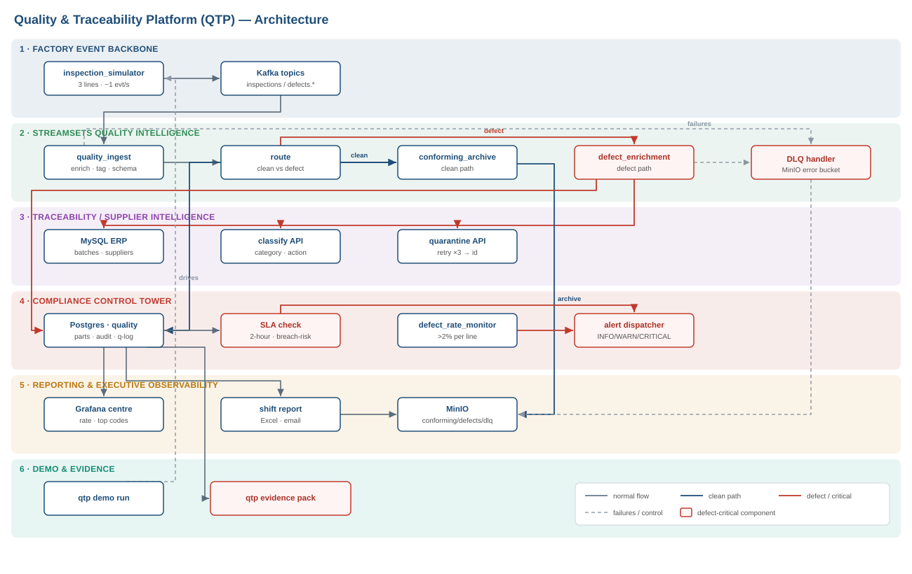

# Quality & Traceability Platform (QTP)

QTP is a real-time quality control and supplier traceability platform for a three-line
production plant. It is built entirely with the IBM StreamSets Control Hub Python SDK. When a
part fails inspection, QTP traces it to its supplier and batch certificate in under two hours,
records every step for audit, and checks the result against five ISO 9001 controls.

[](LICENSE)


Every pipeline, fragment, connection, and job is written as Python and published to Control Hub,
so the whole platform is versioned and can be rebuilt from the repository. Pipelines each do one
job, shared fragments are pinned to commit tags, connections are named, jobs receive their secrets
at runtime, alerts are routed by severity, and the ISO 9001 checks run on a schedule.



<sub>Detailed diagrams, which render inline on GitHub:
[architecture](diagrams/architecture.md) · [sequence](diagrams/sequence.md) · [ERD](diagrams/erd.md)</sub>

### Contents

- [Highlights](#highlights)
- [Good to know](#good-to-know)
- [Prerequisites](#prerequisites)
- [Why it exists](#why-it-exists)
- [Quickstart](#quickstart)
- [Two ways to run it](#two-ways-to-run-it)
- [One-command demo](#one-command-demo)
- [Runbooks](#runbooks)
- [SDK (QTP CLI)](#sdk-qtp-cli)
- [Architecture and diagrams](#architecture-and-diagrams)
- [Repository layout](#repository-layout)
- [Adapting this to another domain](#adapting-this-to-another-domain)
- [Security](#security)
- [Contributing](#contributing)
- [License and credits](#license-and-credits)

## Highlights

- **SDK-authored platform.** A Python package (`qtp/`) builds the pipelines, fragments,
  connections, and jobs and publishes them to Control Hub. Nothing is assembled by hand on the
  canvas.
- **No secrets in pipelines.** Teams, Jira, and database credentials are passed to Control Hub
  as job runtime parameters when the job is created. The committed `pipelines/*.json` exports
  contain none of them.
- **Fragments pinned to tags.** `config/fragment_pins.yaml` pins each shared fragment to an
  immutable commit tag. If a teammate republishes a fragment in the shared workspace, your build
  keeps the version it was pinned to.
- **Alert rollup.** A stateful JavaScript stage sends at most one Teams or Jira alert per line
  and severity every five minutes. The next alert reports how many were held back. A busy line
  stays under the Teams connector's rate limit, Jira does not fill with duplicates, and the audit
  trail still records every defect.
- **Metrics through the SDK.** The engine's own metrics API is locked behind DPM/SSO, so
  `qtp metrics serve` reads live job metrics with `Job.metrics` and `Job.history` and exposes
  them to Prometheus for Grafana.
- **One command per new line.** Per-line ingest and enrichment pipelines are generated from
  `config/lines.yaml`. Adding a fourth production line is `qtp pipelines add-line`.
- **Retries and a dead-letter queue.** The classify, quarantine, and ERP lookup calls retry with
  exponential backoff, and each stage writes failed records to a MinIO dead-letter queue. An
  outage downstream delays a defect; it does not lose one.
- **An operations CLI.** Besides build commands, `qtp` has `preflight`, `jobs`, `metrics`,
  `sla`, `monitor`, `report`, `evidence`, `schedule`, and `demo`, so the same SDK that builds the
  platform also runs it.

## Good to know

- **Everything runs locally.** External systems are mocked. WireMock stands in for the
  defect-classify and quarantine APIs, MySQL for the ERP, Mailhog for SMTP, and MinIO for S3.
  `docker compose up` starts the whole environment with no cloud services.
- **Live pipelines need your own Control Hub.** Publishing pipelines and running jobs requires a
  Control Hub account and a registered Data Collector engine (see
  [Prerequisites](#prerequisites)). The simulator, SDK scripts, demo, and dashboards work
  without one.
- **Some choices are trade-offs.** For example, `inspection_timestamp` is stored as TEXT because
  the StreamSets JDBC Producer did not reliably convert the ISO-8601 string. Queries cast it
  instead. [`diagrams/erd.md`](diagrams/erd.md) explains this and the other schema decisions.

## Prerequisites

| Need | For | Notes |
|------|-----|-------|
| Docker and Docker Compose | The local stack | The only hard requirement for the local demo |
| Python 3.12 | The `qtp` CLI and SDK scripts | `pip install -e .` from the repo root |
| StreamSets Control Hub account | The live pipeline and job path | A free trial works; `qtp demo run` does not need it |
| A registered Data Collector engine | Publishing and running pipelines | Any engine registered to your Control Hub workspace |
| Teams and Jira (optional) | Real alerts instead of local stubs | Falls back to WireMock and Mailhog when unset |

```bash
git clone <your-fork-url> && cd quality-traceability-platform
cp .env.example .env          # then edit .env; read the Security section before going public
pip install -e .              # installs the `qtp` CLI
docker compose up -d          # starts the local environment
```

For the live Control Hub path, set `SCH_URL`, `SCH_CRED_ID`, `SCH_TOKEN`, and `SDC_ID` in `.env`
(each is described in `.env.example`). The local demo does not need them.

## Why it exists

QTP takes raw inspection events from three production lines and turns them into a live view of
quality. Any defective part can be traced to its supplier and certificate within two hours, and
each run produces evidence that the ISO 9001 controls held.

- **Business.** Traceability that used to take about six hours of manual work now finishes in
  under two, so defective parts are contained before they ship. That reduces exposure under EU
  product liability rules and ISO 9001 audits.
- **Technical.** The StreamSets platform is governed and automated through the SDK: pipelines
  with one responsibility each, fragments applied from code, promotion from dev to prod, and
  health checks that run themselves. A new production line takes one command.
- **Compliance.** Every part carries a schema version and an audit record. Every defect is
  classified, quarantined, and traced within the SLA. Every breach raises an alert routed by
  severity and appears in an evidence pack.
- **Demo.** In under ten minutes, the audience sees one critical defect created, caught,
  enriched, traced to its supplier, quarantined, alerted on, and reported.

## Quickstart

```bash
# 1. (optional) override host ports or credentials that clash with your machine
cp .env.example .env

# 2. start the environment (core services, manufacturing stack, and simulator)
docker compose up -d --build

# 3. watch inspection events arrive (CRITICAL defects are injected on a timer)
docker compose logs -f simulator
```

Host ports are remapped in `.env` to avoid clashes with services you already run. The ports the
pipelines use inside the Docker network stay the same (`kafka:29092`, `postgres:5432`, and so
on). The table matches the committed `.env.example`:

| Service | URL / port | Login |
|---------|-----------|-------|
| Grafana | http://localhost:33000 | admin / `${GRAFANA_PASSWORD}` |
| MinIO console | http://localhost:39001 | minioadmin / minioadmin |
| Mailhog UI | http://localhost:38025 | n/a |
| WireMock admin | http://localhost:18080/__admin | n/a |
| Prometheus | http://localhost:39090 | n/a |
| Kafka | localhost:39092 | n/a |
| Postgres (`quality`) | localhost:55432 | qtp / qtp_pw |
| MySQL (`erp`) | localhost:33306 | qtp / qtp_pw |
| qtp-metrics (Prometheus exporter) | http://localhost:9091 | n/a |

Compose starts Kafka with its three topics, Postgres with the `quality` schema, the MySQL ERP
seeded with suppliers and material batches, WireMock with the classify and quarantine stubs,
MinIO with four buckets, Mailhog, Prometheus, Grafana, and the inspection simulator for all
three lines.

```bash
docker compose down        # stop
docker compose down -v     # stop and delete data volumes
```

## Two ways to run it

| | Local / demo path | Live Control Hub path |
|---|---|---|
| Needs | Docker and Python | Also a Control Hub account and engine |
| What runs | Simulator, SDK scripts, dashboards, `qtp demo run` | Published pipelines and jobs processing live Kafka data |
| Alerting | WireMock and Mailhog stubs | Teams and Jira (stubs if unset) |
| Start with | `qtp demo run` | `qtp jobs create --start --wait` |

To explore the patterns, start with the local path. `qtp demo run` covers the full compliance
story without a cloud account. Use the live path when you want real StreamSets pipelines moving
data through your own engine.

## One-command demo

`qtp demo run` tells the whole ISO 9001 story. It seeds the same fixed scenario into the
warehouse and runs the real compliance scripts against it, so the output is identical on every
run, with or without a live Control Hub engine.

```bash
qtp demo run                 # preflight -> seed -> monitor -> SLA -> report -> evidence -> summary
```

On Windows, one script starts the stack, waits for it to become healthy, runs the demo, and
opens the evidence pack:

```powershell
./scripts/demo.ps1           # or:  make demo   (Linux/macOS)
```

The demo runs in eight narrated stages:

1. **Preflight.** A green/red health board for all nine services.
2. **Seed.** The scenario: one CRITICAL part traced to a suspended supplier within the SLA, one
   part that breaches the two-hour SLA, a line pushed over the 2% defect ceiling, and a full
   shift of data. All rows use the `DEMO-*` prefix and are idempotent, so real data is never
   touched.
3. **Defect-rate monitor.** Raises a CRITICAL alert and a Jira ticket for the line over the
   ceiling.
4. **SLA scan.** Escalates every part still untraced after two hours.
5. **SLA chain.** Rebuilds part, batch, supplier, and certificate for the critical part.
6. **Shift report.** Writes an Excel report to MinIO and emails it to Mailhog.
7. **Evidence pack.** Writes `evidence/pack-<ts>/evidence.{json,html}`, an audit report ready
   for screenshots.
8. **Compliance result.** Marks each of the five ISO 9001 controls PASS or FAIL and prints the
   evidence pack path.

Two optional flags add live pipeline activity on top of the fixed scenario:

```bash
qtp demo run --inject-critical   # publish a real CRITICAL inspection event to Kafka
qtp demo run --start-jobs        # start the Control Hub jobs (check the SDK job API on your engine first)
```

## Scheduling the compliance checks

The compliance controls run continuously in production, so they also run on a schedule:

```bash
qtp schedule run                 # in-process: monitor every 5m, SLA scan every 15m, shift reports
qtp schedule install             # write cron, Windows Task Scheduler, and docker-compose files
```

`qtp schedule install` writes a crontab, the Windows `schtasks` commands, and a `qtp-scheduler`
compose service to `scripts/scheduled/`, so you can install the schedule with whatever the host
already uses.

## Runbooks

The three core walkthroughs all use the SDK CLI:

- [x] **Inject a CRITICAL defect and follow it through the pipeline.** Run
  `qtp demo run --inject-critical`, then `qtp sla check --part <id>`.
- [x] **Check the traceability chain in Postgres and MySQL.** `qtp sla check --part DEMO-CRIT-0001`
  prints the chain from part to batch to supplier to certificate.
- [x] **Trigger the two-hour SLA alert.** Run `qtp sla scan`; the seeded part `DEMO-SLA-0002`
  breaches the window.

### Runbook 4: live alerting through Teams, Jira, and email

`manufacturing__defect_enrichment` routes alerts by severity on real defect traffic:

| Severity | Route | Delivery |
|----------|-------|----------|
| CRITICAL | Teams Adaptive Card and a Jira ticket | Workflows webhook · Jira REST v3 (ADF) |
| MAJOR | Teams Adaptive Card (warning) | Workflows webhook |
| MINOR | Email | Engine SMTP relay to Mailhog |

Every CRITICAL and MAJOR alert is also posted to the WireMock audit journal through the shared
`alert_notification_dispatcher` fragment. That journal is the queryable record of all alerts and
feeds the `qtp_alerts_fired_total` metric.

**Rollup.** A stateful stage sends at most one Teams or Jira call per line and severity in each
five-minute window. It counts the defects it holds back and adds the total to the next alert
("+N more since the last alert"). A busy line therefore stays within the Teams connector's action
limit and does not flood Jira, while the audit journal and the Postgres warehouse still record
every defect.

**Secrets stay out of the pipeline.** The pipeline declares placeholder parameters only. The real
Teams webhook and Jira credentials are passed as Control Hub job runtime parameters when the job
is created, so the committed `/pipelines/*.json` exports contain no secrets.

```bash
# 1. put real values in .env (see .env.example for the full list)
#    TEAMS_ALERT_WEBHOOK_URL, JIRA_BASE_URL, JIRA_USER_EMAIL, JIRA_API_TOKEN,
#    JIRA_PROJECT_KEY, JIRA_ISSUE_TYPE

# 2. build and publish the pipelines, then create the jobs (secrets injected here)
qtp pipelines build --name defect_enrichment --replace
qtp pipelines generate --replace
qtp jobs create --start --wait
qtp jobs status

# 3. after changing a secret in .env, push it to the running job without recreating it
qtp jobs update-parameters --restart
```

**Check it live.** Mailhog on port 38025 shows an "INFO: MINOR defect" email, the Teams channel
shows an Adaptive Card, and the Jira project has a "CRITICAL quality defect: part ..." ticket.

MINOR emails need the engine's SMTP relay pointed at Mailhog (`mail.smtp.host=mailhog`,
`mail.smtp.port=1025`). The engine is managed by Control Hub, so set this in the deployment's
Data Collector configuration rather than inside the container. That way it survives restarts.

## SDK (QTP CLI)

`qtp` is a structured Python package. Run `qtp --help` for the full command tree.

| Group | Example | Purpose |
|-------|---------|---------|
| `fragments` | `qtp fragments build` / `list` | Build, publish, and list shared fragments |
| `pipelines` | `qtp pipelines generate` | Generate per-line ingest and defect pipelines from `lines.yaml` |
| `pipelines` | `qtp pipelines add-line --id line_4` | Add a new production line |
| `pipelines` | `qtp pipelines promote --name <p> --to prod` | Promote between environments using `env_map` |
| `pipelines` | `qtp pipelines export` | Export published pipelines as importable JSON to `/pipelines` |
| `connections` | `qtp connections create` / `list` | Named Control Hub connections (Postgres, MySQL, MinIO, Kafka) |
| `sla` | `qtp sla check --part <id>` / `scan` | Traceability and two-hour SLA enforcement |
| `monitor` | `qtp monitor defect-rate` | Per-line defect-rate check |
| `report` | `qtp report shift --shift A --date <d>` | Shift quality report (Excel to MinIO and Mailhog) |
| `preflight` | `qtp preflight run` | Service health board |
| `demo` | `qtp demo run` | End-to-end compliance demonstration |
| `evidence` | `qtp evidence pack` | Compliance evidence pack (JSON and HTML audit report) |
| `schedule` | `qtp schedule run` / `install` | Recurring compliance schedule |
| `jobs` | `qtp jobs status` / `create` / `start` / `stop` | Control Hub job lifecycle (live path) |
| `jobs` | `qtp jobs update-parameters --restart` | Push changed `.env` secrets to an existing job |
| `metrics` | `qtp metrics serve` | Prometheus exporter for Control Hub job metrics |
| `teardown` | `qtp teardown run` | Remove the demo's `DEMO-*` rows |

## Architecture and diagrams

[`diagrams/architecture.svg`](diagrams/architecture.svg) is the one-page overview shown at the top
of this README and is sized for slides. The three Mermaid diagrams below match the deployed
build and render inline on GitHub:

| Diagram | Shows |
|---------|-------|
| [`diagrams/architecture.md`](diagrams/architecture.md) | Data flow from ingest through enrichment, severity routing, alerting, the warehouse, and observability |
| [`diagrams/sequence.md`](diagrams/sequence.md) | One CRITICAL defect followed across every system, from inspection to a closed SLA record |
| [`diagrams/erd.md`](diagrams/erd.md) | The `quality` (Postgres) and `erp` (MySQL) data models |

The platform has six layers:

1. **Event backbone.** Kafka carries inspection events from three lines (`inspection_simulator`).
2. **Ingest pipeline** (`quality_ingest`). Adds header, quality, and schema metadata, splits clean
   parts from defects, and sends errors to the dead-letter queue.
3. **Enrichment pipeline** (`defect_enrichment`). Joins the ERP for traceability, classifies the
   defect, registers a mandatory quarantine (up to three retries), and routes alerts by severity
   through the rollup stage.
4. **Compliance checks.** Two-hour SLA, quarantine, schema versioning, audit, and defect rate.
5. **Observability and reporting.** Prometheus exporter, Grafana dashboards, and the shift Excel
   report.
6. **Demo and evidence.** The one-command demonstration and generated audit evidence packs.

## Repository layout

| Path | Contents |
|------|----------|
| `/pipelines` | Exported StreamSets pipeline JSON, importable into Control Hub |
| `/qtp` | Python SDK package (CLI: `qtp <group> <action>`) and `requirements.txt` |
| `/diagrams` | Architecture overview (SVG), architecture, ERD, and sequence diagrams (Mermaid) |
| `/config` | `lines.yaml`, `env_map.yaml`, `fragment_pins.yaml` |
| `/evidence` | Screenshots, logs, reports, and evidence packs |

## Adapting this to another domain

The alerting, governance, and pipeline generation do not depend on manufacturing. To use them
for banking, telemetry, logistics, or another domain:

1. **Change the source.** Point `inspection_simulator`, or your own producer, at your Kafka topic
   and record shape.
2. **Rewrite the two builders.** `qtp/pipelines/quality_ingest.py` and `defect_enrichment.py`
   are plain Python functions that return a pipeline ready to publish. Change the enrichment,
   lookups, and destinations and keep the structure.
3. **Reuse the fragments.** Header enrichment, schema versioning, DLQ handling, and the alert
   dispatcher are already generic. Only the required-field list in `data_quality_tagger` is
   specific to this scenario.
4. **Keep the governance patterns.** Tag-pinned fragments, named connections, runtime secret
   injection, per-line generation from `config/lines.yaml`, and the ops CLI carry over as they
   are. These are the parts most worth copying.

Configuration lives in `config/` (`lines.yaml`, `env_map.yaml`, `fragment_pins.yaml`), so most of
the work of retargeting is editing data rather than code.

## Security

- **Never commit `.env`.** It holds real credentials and is gitignored. `.env.example` is the
  committed template; keep real values out of it.
- **Before making a fork public**, search the history for anything sensitive:
  ```bash
  git log -p | grep -iE "ATATT|token|password|webhook|secret"   # should return nothing meaningful
  ```
  If a secret was ever committed, rotate it and rewrite history with `git filter-repo`. Deleting
  it in a later commit leaves it in the history.
- **Pipeline definitions hold no secrets.** Credentials arrive as Control Hub job runtime
  parameters when the job is created, so the exported `/pipelines/*.json` files are safe to
  commit.
- **TLS material** in `certs/` is gitignored. Regenerate it locally with
  `scripts/gen-minio-cert.sh`.
- The default local passwords (`qtp_pw`, `minioadmin`) are for the disposable local stack only.
  Do not reuse them anywhere else.
- To report a vulnerability, open a private report rather than a public issue.

## Contributing

Issues and pull requests are welcome. QTP started as a learning project, so clear code and
documented trade-offs count as much as new features. When you contribute:

- Author pipelines and fragments with the SDK. Do not commit hand-edited canvas exports.
- Check your change locally before opening a pull request: run `py -3.12 -m py_compile` on the
  modules you changed, then `qtp preflight run` and `qtp demo run` against the local stack.
- Keep the diagrams in `diagrams/` in step with the deployed build. Update them in the same pull
  request as any change to the data flow or schema.

## License and credits

QTP is released under the MIT License; see [LICENSE](LICENSE). You may use, adapt, and build on
it, and attribution is appreciated.

- Written by Syeda Eman Fatima.
- Built on [StreamSets Control Hub](https://streamsets.com/) and its Python SDK, with Apache
  Kafka, PostgreSQL, MySQL, MinIO, WireMock, Mailhog, Prometheus, and Grafana, all run from their
  official Docker images.
