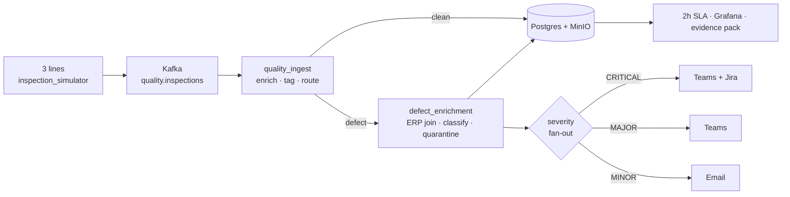

# Quality & Traceability Platform (QTP)

Real-time production-line quality control and supplier traceability, built **entirely through the IBM
StreamSets Control Hub Python SDK**. Trace any defective part back to its supplier and batch
certificate in under two hours: automatically, auditably, and ISO 9001-ready.

[](LICENSE)


An SDK-first, governed StreamSets data platform: single-responsibility pipelines, tag-pinned
shared fragments, named connections, secretless job execution, severity-routed alerting, and
continuous ISO 9001 compliance checks. Every pipeline, fragment, connection, and job is authored
as code and published to Control Hub, versioned and repeatable, rather than clicked together on
the canvas.



<sub>Full diagrams (they render inline on GitHub):
[architecture](diagrams/architecture.md) · [sequence](diagrams/sequence.md) · [ERD](diagrams/erd.md)</sub>

### Contents

- [Highlights](#highlights)
- [Good to know](#good-to-know)
- [Prerequisites](#prerequisites)
- [Quickstart](#quickstart-60-seconds)
- [Two ways to run it](#two-ways-to-run-it)
- [One-command demo](#one-command-demo)
- [Runbooks](#runbooks)
- [SDK (QTP CLI)](#sdk-qtp-cli)
- [Architecture & diagrams](#architecture--diagrams)
- [Repository layout](#repository-layout)
- [Adapting this to another domain](#adapting-this-to-another-domain)
- [Security](#security)
- [Contributing](#contributing)
- [License & credits](#license--credits)

## Highlights

The parts worth reading the code for:

- **Everything is SDK-authored.** Pipelines, fragments, connections, and jobs are built by a
  Python package (`qtp/`) and published to Control Hub. 
- **Secretless pipelines.** Teams/Jira/DB credentials are injected as Control Hub *job runtime
  parameters* at job-creation time, so the committed `pipelines/*.json` exports contain no secrets.
- **Tag-pinned fragments.** Shared fragments are pinned to immutable commit tags
  (`config/fragment_pins.yaml`), so a teammate's republish in a shared workspace can never
  silently rewrite your build.
- **Stateful rollup rate-gate.** A JavaScript stage caps outbound Teams/Jira alerts to one per
  `(line, severity)` per 5-minute window and reports the suppressed count on the next alert, so a
  hot line never trips the connector's rate limit or floods Jira, and no audit record is dropped.
- **SDK-scraped metrics.** The engine's own metrics API is DPM/SSO-locked, so `qtp metrics serve`
  reads live job metrics through the Control Hub SDK (`Job.metrics` / `Job.history`) and exposes
  them to Prometheus for Grafana.
- **One-command line onboarding.** Per-line ingest + enrichment pipelines are generated from
  `config/lines.yaml`; a fourth production line is a single `qtp pipelines add-line`.
- **Retry + DLQ on every external call.** Classify, quarantine, and the ERP lookup are
  retry-wrapped with exponential backoff, with a MinIO dead-letter queue behind every stage so a
  downstream outage never silently loses a defect.
- **A real ops CLI, not just build scripts.** `preflight`, `jobs`, `metrics`, `sla`, `monitor`,
  `report`, `evidence`, `schedule`, and `demo` mean the SDK operates the platform.

## Good to know

- **It runs fully locally.** External systems are mocked: WireMock stubs the defect-classify and
  quarantine APIs, MySQL stands in for an ERP, Mailhog for SMTP, MinIO for S3. `docker compose up`
  gives you the whole environment with no cloud dependencies for the local/demo path.
- **The live pipeline path needs your own StreamSets Control Hub.** Publishing pipelines and
  running jobs requires a Control Hub account plus a registered Data Collector engine (see
  [Prerequisites](#prerequisites)). Everything else (the simulator, the SDK scripts, the demo,
  the dashboards) works without it.
- **Engineering trade-off:** For example, `inspection_timestamp` is stored as
  TEXT because StreamSets' JDBC Producer would not reliably coerce the ISO-8601 string; it is cast
  in queries instead (see [`diagrams/erd.md`](diagrams/erd.md)). 

---

## Prerequisites

| Need | For | Notes |
|------|-----|-------|
| **Docker + Docker Compose** | The whole local stack | Only hard requirement for the local/demo path |
| **Python 3.12** | The `qtp` CLI / SDK scripts | `pip install -e .` from the repo root |
| **StreamSets Control Hub account** | The *live* pipeline/job path only | Free trial works; not needed for `qtp demo run` |
| **A registered Data Collector engine** | Publishing + running pipelines | Any engine registered to your Control Hub workspace |
| *(optional)* Real Teams / Jira | Live alerting beyond the local stubs | Everything falls back to WireMock/Mailhog if absent |

```bash
git clone https://github.com/eman-fj/quality-traceability-platform.git && cd quality-traceability-platform
cp .env.example .env          # then edit .env; see the Security section before going public
pip install -e .              # installs the `qtp` CLI
docker compose up -d          # boots the full local environment
```

For the live Control Hub path, set `SCH_URL`, `SCH_CRED_ID`, `SCH_TOKEN`, and `SDC_ID` in `.env`
(all documented in `.env.example`). If you only want the local demo, you can skip those.

---

## Vision

QTP turns three production lines of raw inspection events into a real-time quality command centre that traces any defective part back to its supplier and certificate in under two hours: automatically, auditably, and provably ISO 9001 compliant.

### Value statements

- **Business**: Replaces a 6-hour manual traceability process with sub-2-hour automated
  traceability, containing defects before they ship and protecting against EU
  product-liability and ISO 9001 compliance risk.
- **Technical**: A governed, SDK-automated StreamSets platform: single-responsibility
  pipelines, programmatic fragment application, dev-to-prod promotion, and self-validating
  health checks that onboard a new production line with one command.
- **Compliance / governance**: Every part is schema-versioned and audited; every defect is
  classified, quarantined, and traced within an enforced SLA; every breach raises a
  severity-routed alert and an auditable evidence pack.
- **Demo**: A single critical defect is born, caught, enriched, traced to its supplier,
  quarantined, alerted, and reported live, in under ten minutes.

---

## Quickstart (60 seconds)

```bash
# 1. (optional) override any clashing host ports / creds
cp .env.example .env

# 2. boot the whole environment (core + manufacturing specialist stack + simulator)
docker compose up -d --build

# 3. watch inspection events flow (CRITICAL defects injected on a timer)
docker compose logs -f simulator
```

Host ports are **remapped in `.env`** to avoid clashes with anything already running (the
in-network ports the pipelines use are unchanged: `kafka:29092`, `postgres:5432`, etc.).
Defaults below match the committed `.env.example`:

| Service | URL / port | Login |
|---------|-----------|-------|
| Grafana | http://localhost:33000 | admin / `${GRAFANA_PASSWORD}` |
| MinIO console | http://localhost:39001 | minioadmin / minioadmin |
| Mailhog UI | http://localhost:38025 | n/a |
| WireMock admin | http://localhost:18080/__admin | n/a |
| Prometheus | http://localhost:39090 | n/a |
| Kafka | localhost:39092 | n/a |
| Postgres (`quality`) | localhost:55432 | qtp / qtp_pw |
| MySQL (`erp`) | localhost:33306 | qtp / qtp_pw |
| qtp-metrics (Prometheus exporter) | http://localhost:9091 | n/a |

**What boots:** Kafka (+ 3 topics auto-created), Postgres (`quality` schema), MySQL ERP
(suppliers + material_batches seeded), WireMock (classify + quarantine stubs), MinIO (4 buckets
auto-created), Mailhog, Prometheus, Grafana, and the inspection simulator producing events for
all three lines.

```bash
docker compose down        # stop
docker compose down -v     # stop + wipe data volumes
```

---

## Two ways to run it

| | **Local / demo path** | **Live Control Hub path** |
|---|---|---|
| **Needs** | Docker + Python only | + a StreamSets Control Hub account & engine |
| **What runs** | Simulator, SDK scripts, dashboards, `qtp demo run` | Real published pipelines + jobs processing live Kafka |
| **Alerting** | WireMock / Mailhog stubs | Real Teams / Jira (or stubs, if unset) |
| **Start with** | `qtp demo run` | `qtp jobs create --start --wait` |

If you're just here to explore the patterns, stay on the **local path**: `qtp demo run` tells
the entire compliance story end to end without any cloud account. Reach for the live path only
when you want to see real StreamSets pipelines moving real data through your own engine.

---

## One-command demo

The entire ISO 9001 story runs from a single command. It's **deterministic and repeatable**: it
just seeds the same fixed scenario into the warehouse and runs the real compliance scripts
against that data, so you get the same complete story every time, whether or not a live
Control Hub engine is attached.

```bash
qtp demo run                 # preflight -> seed -> monitor -> SLA -> report -> evidence -> summary
```

On Windows, one script also boots the stack, waits for health, runs the demo, and opens the
evidence pack:

```powershell
./scripts/demo.ps1           # or:  make demo   (Linux/macOS)
```

What `qtp demo run` does, as eight narrated stages:

1. **Preflight**: GREEN/RED health board for all nine services.
2. **Seed**: the golden thread: one CRITICAL part traced to a SUSPENDED supplier (SLA *met*),
   one part breaching the 2-hour SLA, a line pushed over the 2% defect ceiling, and a full
   shift dataset. All rows are namespaced `DEMO-*` and idempotent, so they never touch real data.
3. **Defect-rate monitor**: fires a CRITICAL alert + Jira ticket for the hot line.
4. **SLA scan**: escalates every part untraced past two hours.
5. **SLA chain**: reconstructs part -> batch -> supplier -> certificate for the hero part.
6. **Shift report**: Excel to MinIO + email to Mailhog.
7. **Evidence pack**: `evidence/pack-<ts>/evidence.{json,html}` (screenshot-ready audit report).
8. **Compliance result**: each of the five ISO 9001 controls resolved to PASS/FAIL, with the evidence pack path.

Opt-in **live overlays** layer real pipeline activity on top of the deterministic story:

```bash
qtp demo run --inject-critical   # publish a real CRITICAL inspection event to Kafka
qtp demo run --start-jobs        # start the Control Hub jobs (verify SDK job API on your engine)
```

## Scheduling the compliance cadence

The compliance controls are recurring duties, not one-shots. Run them on a schedule:

```bash
qtp schedule run                 # in-process: monitor (5m) + SLA scan (15m) + shift reports
qtp schedule install             # write cron / Windows Task Scheduler / docker-compose artefacts
```

`qtp schedule install` writes ready-to-use artefacts to `scripts/scheduled/` (a crontab, the
Windows `schtasks` commands, and a `qtp-scheduler` compose service) so the cadence installs the
native way on any host.

## Runbooks

The three core walkthroughs, all driven by the SDK CLI:

- [x] **Inject a CRITICAL defect and trace it through the full pipeline**: `qtp demo run --inject-critical`, then `qtp sla check --part <id>`.
- [x] **Verify the traceability chain in Postgres and MySQL**: `qtp sla check --part DEMO-CRIT-0001` prints the full part -> batch -> supplier -> certificate chain.
- [x] **Trigger the 2-hour SLA alert with the traceability checker**: `qtp sla scan` (the seeded `DEMO-SLA-0002` part breaches the 2-hour window).

### Runbook 4: Real-time alerting (Teams · Jira · Email) on the live pipeline

`manufacturing__defect_enrichment` performs **severity-routed alerting** on real defect
traffic, not just the WireMock stubs:

| Severity | Route | Delivery |
|----------|-------|----------|
| CRITICAL | Teams Adaptive Card **+** Jira ticket | Workflows webhook · Jira REST v3 (ADF) |
| MAJOR | Teams Adaptive Card (WARN) | Workflows webhook |
| MINOR | Email | engine SMTP relay -> Mailhog |

Every CRITICAL/MAJOR also posts to the WireMock **audit journal** (the reused
`alert_notification_dispatcher` fragment), the central, queryable alert trail that backs the
`qtp_alerts_fired_total` metric.

**Rate control (rollup):** a stateful gate caps outbound Teams/Jira calls to one per
`(line, severity)` per 5-minute window; suppressed defects are counted and the total is
reported on the next alert ("+N more since the last alert"). This prevents a hot line from
tripping the Teams connector's action-limit or flooding Jira, while the audit journal and the
Postgres warehouse still record 100% of defects.

**Secrets are never in the pipeline.** The pipeline declares only placeholder parameters; the
real Teams webhook and Jira credentials are injected as **Control Hub job runtime parameters**
at job-creation time, so the committed `/pipelines/*.json` exports contain no secrets.

```bash
# 1. put real values in .env (see .env.example for the full list)
#    TEAMS_ALERT_WEBHOOK_URL, JIRA_BASE_URL, JIRA_USER_EMAIL, JIRA_API_TOKEN,
#    JIRA_PROJECT_KEY, JIRA_ISSUE_TYPE

# 2. build + publish the pipelines, then create the jobs (secrets injected here)
qtp pipelines build --name defect_enrichment --replace
qtp pipelines generate --replace
qtp jobs create --start --wait
qtp jobs status

# 3. if you later change a secret in .env, push it to a running job without recreating it
qtp jobs update-parameters --restart
```

**Verify live:** Mailhog `:38025` shows a new "INFO: MINOR defect" email; the Teams channel
shows an Adaptive Card; the Jira project shows a "CRITICAL quality defect: part ..." ticket.

The MINOR email tier needs the engine's SMTP relay pointed at Mailhog (`mail.smtp.host=mailhog`, `mail.smtp.port=1025`). Because the engine is Control Hub-managed, set this in the **deployment's Data Collector Configuration** (not by editing the container), so it survives restarts.

## SDK (QTP CLI)

Structured Python package. Run `qtp --help` for the full command tree.

| Group | Example | Purpose |
|-------|---------|---------|
| `fragments` | `qtp fragments build` / `list` | Build, publish, and list shared fragments |
| `pipelines` | `qtp pipelines generate` | Generate per-line ingestion + defect pipelines from `lines.yaml` |
| `pipelines` | `qtp pipelines add-line --id line_4` | Onboard a new production line |
| `pipelines` | `qtp pipelines promote --name <p> --to prod` | Environment promotion via env_map |
| `pipelines` | `qtp pipelines export` | Export published pipelines to importable JSON in `/pipelines` |
| `connections` | `qtp connections create` / `list` | Named Control Hub connections (Postgres/MySQL/MinIO/Kafka) |
| `sla` | `qtp sla check --part <id>` / `scan` | Traceability + 2-hour SLA enforcement |
| `monitor` | `qtp monitor defect-rate` | Per-line defect-rate compliance check |
| `report` | `qtp report shift --shift A --date <d>` | Shift quality report (Excel to MinIO + Mailhog) |
| `preflight` | `qtp preflight run` | Service health board |
| `demo` | `qtp demo run` | **One-command end-to-end compliance demonstration** |
| `evidence` | `qtp evidence pack` | Compliance evidence pack (JSON + HTML audit report) |
| `schedule` | `qtp schedule run` / `install` | Recurring compliance cadence |
| `jobs` | `qtp jobs status` / `create` / `start` / `stop` | Control Hub job lifecycle (the live path) |
| `jobs` | `qtp jobs update-parameters --restart` | Re-inject changed `.env` secrets into an existing job |
| `metrics` | `qtp metrics serve` | Prometheus exporter for real Control Hub job metrics |
| `teardown` | `qtp teardown run` | Remove the demo's `DEMO-*` footprint |

---

## Architecture & diagrams

Three views of the system are maintained and kept accurate to the deployed build. All three are
Mermaid, so they render inline when viewed on GitHub:

| Diagram | Shows |
|---------|-------|
| [`diagrams/architecture.md`](diagrams/architecture.md) | End-to-end data flow: ingest, enrichment, severity fan-out, alerting, warehouse, observability |
| [`diagrams/sequence.md`](diagrams/sequence.md) | One CRITICAL defect traced across every system, from inspection to a closed 2-hour SLA record |
| [`diagrams/erd.md`](diagrams/erd.md) | The `quality` (Postgres) and `erp` (MySQL) data model |

The platform is organised as:

1. **Event backbone**: Kafka inspection events from three lines (`inspection_simulator`).
2. **Ingest pipeline** (`quality_ingest`): header/quality/schema enrichment, clean/defect
   routing, DLQ on error.
3. **Enrichment pipeline** (`defect_enrichment`): ERP traceability join, classification,
   mandatory quarantine (retry ×3), and severity-routed alerting with a rollup rate-gate.
4. **Compliance control tower**: 2-hour SLA, quarantine, schema versioning, audit, defect-rate.
5. **Observability & reporting**: Prometheus exporter + Grafana dashboards + shift Excel report.
6. **Demo & evidence**: one-command demonstration + auto-generated audit evidence packs.

---

## Repository layout

| Path | Contents |
|------|----------|
| `/pipelines` | Exported StreamSets pipeline JSON (importable into Control Hub) |
| `/qtp` | Python SDK package (CLI: `qtp <group> <action>`) + `requirements.txt` |
| `/diagrams` | Architecture diagram, ERD, sequence diagram (Mermaid) |
| `/config` | `lines.yaml`, `env_map.yaml`, `fragment_pins.yaml` |
| `/evidence` | Screenshots, logs, reports, evidence packs (captured as work proceeds) |

---

## Adapting this to another domain

The alerting, governance, and generation spine is domain-agnostic. To retarget it (banking,
telemetry, logistics, and so on):

1. **Swap the source contract**: point `inspection_simulator` (or your real producer) at your own
   Kafka topic and record shape.
2. **Rewrite the two builders**: `qtp/pipelines/quality_ingest.py` and `defect_enrichment.py` are
   plain Python functions returning a published-ready pipeline; change the enrichment, lookup, and
   destinations, keep the structure.
3. **Reuse the fragments as-is**: header enrichment, schema versioning, DLQ handling, and the
   alert dispatcher are already generic; only `data_quality_tagger`'s required-field list is
   scenario-specific.
4. **Keep the governance patterns unchanged**: tag-pinned fragments, named connections, runtime
   secret injection, per-line generation from `config/lines.yaml`, and the ops CLI carry over
   directly. These are the parts worth copying.

The config lives in `config/` (`lines.yaml`, `env_map.yaml`, `fragment_pins.yaml`), so most
retargeting is data, not code.

## Security

- **Never commit `.env`.** It holds real credentials and is gitignored by default. `.env.example`
  is the safe, committed template; keep real values out of it.
- **Before making a fork public**, scan history for anything sensitive:
  ```bash
  git log -p | grep -iE "ATATT|token|password|webhook|secret"   # should return nothing meaningful
  ```
  If a secret was ever committed, rotate it and scrub history (`git filter-repo`); removing it
  in a later commit is not enough.
- **Secrets never enter pipeline definitions.** Credentials are injected as Control Hub *job
  runtime parameters* at job-creation time, so the exported `/pipelines/*.json` are safe to commit.
- **TLS material** (`certs/`) is gitignored; regenerate locally with `scripts/gen-minio-cert.sh`.
- The default local passwords (`qtp_pw`, `minioadmin`) are for the throwaway local stack only;
  never reuse them anywhere real.
- Found a vulnerability? Please open a private report rather than a public issue.

## Contributing

Issues and PRs are welcome. This started as a learning project, so clarity and documented
trade-offs are valued as much as features. If you contribute:

- Keep pipelines/fragments **SDK-authored**: no hand-edited canvas exports.
- Verify locally before opening a PR: `py -3.12 -m py_compile` on changed modules, plus
  `qtp preflight run` / `qtp demo run` against the local stack.
- The diagrams in `diagrams/` are kept accurate to the deployed build; update them alongside any
  change to the data flow or schema.

## License & credits

Released under the **MIT License**; see [LICENSE](LICENSE). You're free to use, adapt, and build
on it, and attribution is appreciated.

- Authored by **Syeda Eman Fatima**.
- Uses [StreamSets Control Hub](https://streamsets.com/) and its Python SDK, plus Apache Kafka,
  PostgreSQL, MySQL, MinIO, WireMock, Mailhog, Prometheus, and Grafana, all via their official
  Docker images.

