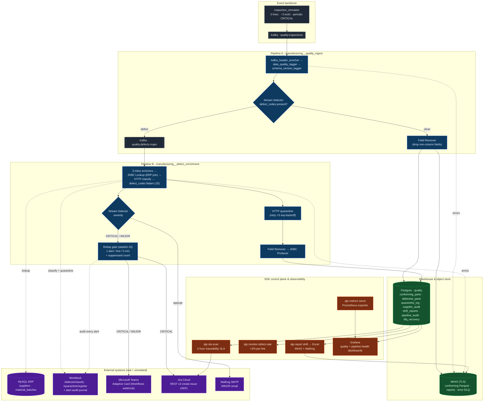

# QTP: System Architecture

Production-line quality control and supplier traceability for an automotive-components
manufacturer (3 lines). Every part is inspected; defective parts must be traced to their
raw-material supplier and batch certificate **within 2 hours** (ISO 9001 / EU product
liability). This diagram reflects the *as-built* system, not an aspiration.

> Authoring model: every pipeline and fragment is built and published to StreamSets Control
> Hub through the Python SDK (`qtp` CLI) - nothing is hand-drawn on the canvas. Credentials
> are injected as Control Hub **job runtime parameters** at job-creation time, never baked
> into the pipeline definition or the committed JSON exports.

## Reading the diagram

- **Clean path** (high volume): ingest → enrich/tag/stamp → Field Remover → `conforming_parts`
  in Postgres, and conforming Parquet in MinIO via `manufacturing__conforming_archive`.
- **Defect path**: republished to `quality.defects.major`, then enriched - ERP batch→supplier
  join, HTTP classification, a JS step that flattens the `defect_codes` list to a clean
  string, and a mandatory quarantine call (3× exponential-backoff retry) - before landing in
  `defective_parts` with a `quarantine_id`.
- **Severity fan-out**: a Stream Selector splits CRITICAL / MAJOR / MINOR. CRITICAL → Teams +
  Jira; MAJOR → Teams; MINOR → email. Every CRITICAL/MAJOR also hits the WireMock audit sink.
- **Rollup gate**: a stateful JavaScript stage caps outbound Teams/Jira calls to one per line
  per 5-minute window and carries the suppressed count onto the next alert - this is what
  keeps the Teams connector and Jira from being flooded, without dropping any audit data.
- **2-hour SLA loop**: `qtp sla scan` polls `defective_parts` for parts past the window with
  no completed traceability and escalates (CRITICAL alert + Jira ticket).
- **Governance**: named Control Hub connections for Postgres/MySQL/MinIO/Kafka; fragments
  pinned to immutable commit tags; job secrets injected at runtime; every external call is
  retry-wrapped with a MinIO dead-letter queue behind it.
