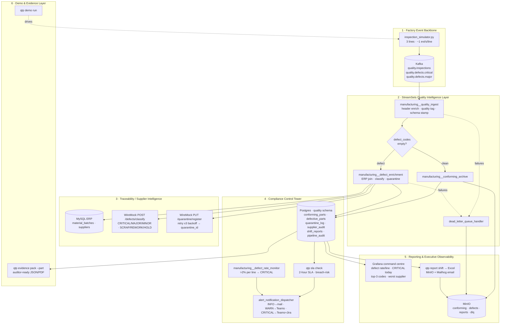

# QTP — Six-Layer Architecture

End-to-end data flow for Production Line Quality Control & Supplier Traceability.
A rendered image lives at [`architecture.svg`](architecture.svg) (also copied to `/evidence`).

## Reading the diagram
- **Clean path** (Layer 2 → Archive → Postgres + MinIO Parquet) is the high-volume happy path.
- **Defect path** fans out to ERP traceability, classification, and quarantine, then lands
  enriched in Postgres with a `quarantine_id`.
- **The 2-hour SLA loop** (Layer 4) polls defective parts lacking completed traceability and
  escalates before the window closes.
- **Every external call** (ERP, classify, quarantine) is wrapped with retry + DLQ.
