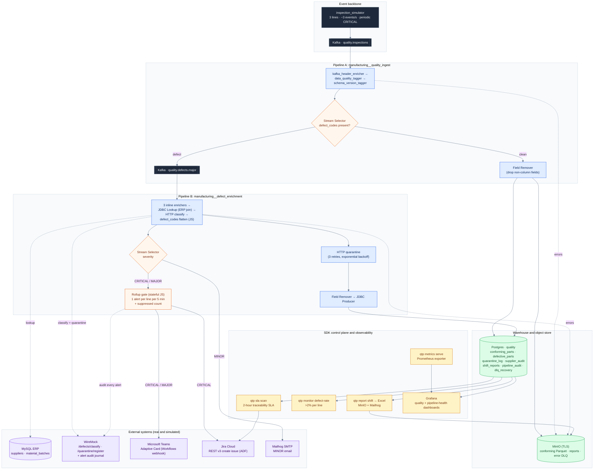

# QTP: system architecture

QTP handles quality control and supplier traceability for an automotive components manufacturer
with three production lines. Every part is inspected. Under ISO 9001 and EU product liability
rules, a defective part must be traced to its raw-material supplier and batch certificate within
two hours. The diagram shows the system as built.

For slides, use the one-page overview in [`architecture.svg`](architecture.svg).

> Every pipeline and fragment is built and published to StreamSets Control Hub through the
> Python SDK (`qtp` CLI); none is drawn by hand on the canvas. Credentials reach the pipelines
> as Control Hub job runtime parameters when the job is created, so they never appear in the
> pipeline definition or the committed JSON exports.

## Reading the diagram

- **Clean path** (high volume). Records are enriched, tagged, and stamped with a schema version,
  pass through a Field Remover, and land in `conforming_parts` in Postgres.
  `manufacturing__conforming_archive` also writes them to MinIO as Parquet.
- **Defect path.** Defects are republished to `quality.defects.major` and enriched: an ERP join
  from batch to supplier, an HTTP classification call, a JavaScript step that flattens the
  `defect_codes` list into a string, and a mandatory quarantine call with up to three retries
  and exponential backoff. The record then lands in `defective_parts` with its `quarantine_id`.
- **Severity routing.** A Stream Selector splits CRITICAL, MAJOR, and MINOR. CRITICAL goes to
  Teams and Jira, MAJOR to Teams, and MINOR to email. Every CRITICAL and MAJOR alert is also
  written to the WireMock audit journal.
- **Rollup gate.** A stateful JavaScript stage sends at most one Teams or Jira call per line in
  each five-minute window and adds the number it held back to the next alert. This keeps the
  Teams connector and Jira from being flooded, and no audit data is dropped.
- **Two-hour SLA loop.** `qtp sla scan` polls `defective_parts` for parts past the window
  without completed traceability and escalates each one with a CRITICAL alert and a Jira ticket.
- **Governance.** Postgres, MySQL, MinIO, and Kafka are reached through named Control Hub
  connections. Fragments are pinned to immutable commit tags, job secrets are injected at
  runtime, and every external call retries with a MinIO dead-letter queue behind it.
