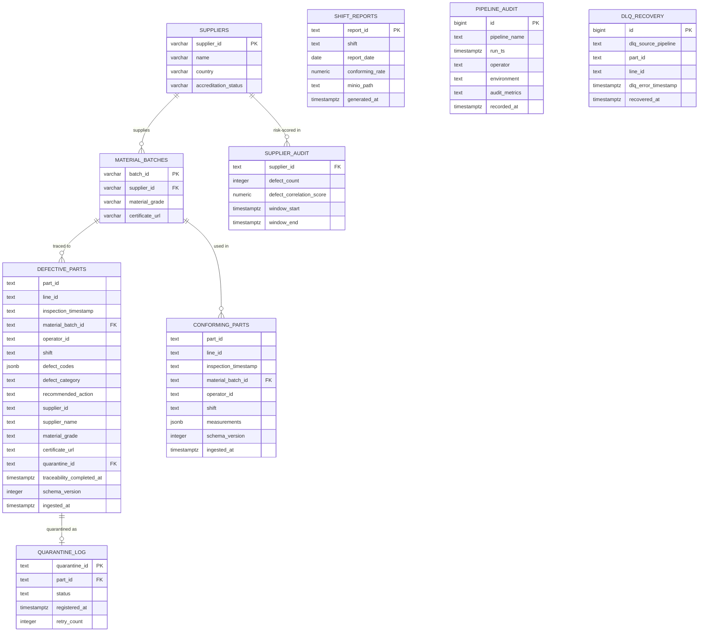

# QTP: Entity Relationship Diagram

Two databases span the traceability chain: **`erp`** (MySQL - simulated supplier/ERP system
of record) and **`quality`** (Postgres - the quality warehouse: pipeline destinations, SLA
state, audit). The join across the boundary is `defective_parts.material_batch_id →
material_batches.batch_id`, resolved at runtime by the `defect_enrichment` JDBC Lookup.

> Column types below are the *actual* deployed schema. Note `inspection_timestamp` is stored
> as **TEXT** (StreamSets' JDBC Producer would not coerce the ISO-8601 string into a
> `TIMESTAMP` column reliably, so the value is kept verbatim and cast in queries) - a real
> engineering decision, documented rather than hidden.

## Notes

- **2-hour SLA** is computed as `traceability_completed_at - inspection_timestamp` on
  `DEFECTIVE_PARTS`; `qtp sla scan` escalates any part past the window with the field null.
- **`PIPELINE_AUDIT`** is written by the `audit_log_writer` fragment; `audit_metrics` holds a
  serialized metrics blob (record/error/critical counts) per run - one row per pipeline run.
- **`DLQ_RECOVERY`** captures the identity of records that failed a stage and were archived to
  the MinIO DLQ (SDC's error-record format discards per-stage metadata on re-read, so recovery
  reconstructs `part_id`/`line_id`/source/time rather than the full failed record).
- **`schema_version`** (from `schema_version_tagger`) is present on every part row - the ISO
  "schema version on every record" control.
- **`SUPPLIER_AUDIT.defect_correlation_score`** backs the "worst supplier" Grafana panel and
  the shift report's supplier-risk section.
- Referential integrity across the MySQL↔Postgres boundary is enforced *in the pipeline*
  (the JDBC Lookup), not by a database FK - the ERD shows the logical relationship.
