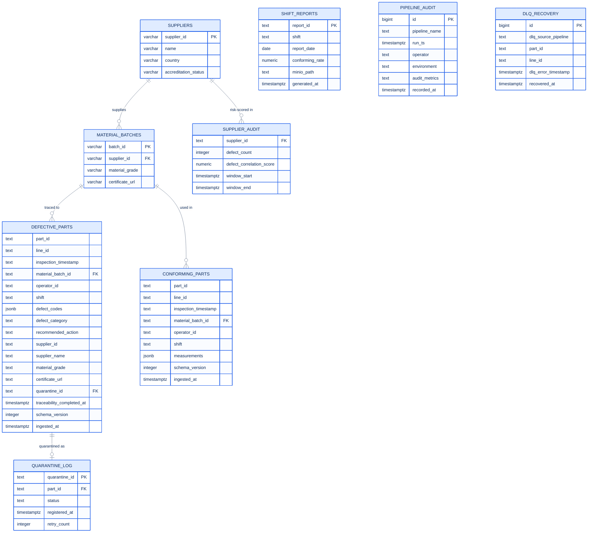

# QTP: entity relationship diagram

The traceability chain spans two databases. `erp` (MySQL) is the simulated supplier and ERP
system of record. `quality` (Postgres) is the quality warehouse, holding pipeline output, SLA
state, and audit records. The link between them is `defective_parts.material_batch_id →
material_batches.batch_id`, which the `defect_enrichment` JDBC Lookup resolves at runtime.

> The column types below are the deployed schema. `inspection_timestamp` is stored as TEXT
> because the StreamSets JDBC Producer did not reliably convert the ISO-8601 string into a
> `TIMESTAMP` column. The value is kept as received and cast in queries.

## Notes

- The **two-hour SLA** is `traceability_completed_at - inspection_timestamp` on
  `DEFECTIVE_PARTS`. `qtp sla scan` escalates any part past the window whose
  `traceability_completed_at` is still null.
- **`PIPELINE_AUDIT`** is written by the `audit_log_writer` fragment, one row per pipeline run.
  `audit_metrics` holds the serialized record, error, and critical counts for that run.
- **`DLQ_RECOVERY`** records which records failed a stage and were archived to the MinIO
  dead-letter queue. The Data Collector error-record format drops per-stage metadata when it is
  read back, so recovery rebuilds `part_id`, `line_id`, the source, and the time rather than the
  full failed record.
- **`schema_version`**, set by `schema_version_tagger`, is on every part row. This is the ISO
  control that requires a schema version on every record.
- **`SUPPLIER_AUDIT.defect_correlation_score`** drives the "worst supplier" Grafana panel and the
  supplier risk section of the shift report.
- No database foreign key crosses the MySQL and Postgres boundary. The pipeline enforces the
  relationship through the JDBC Lookup, and the ERD shows it as a logical link.
