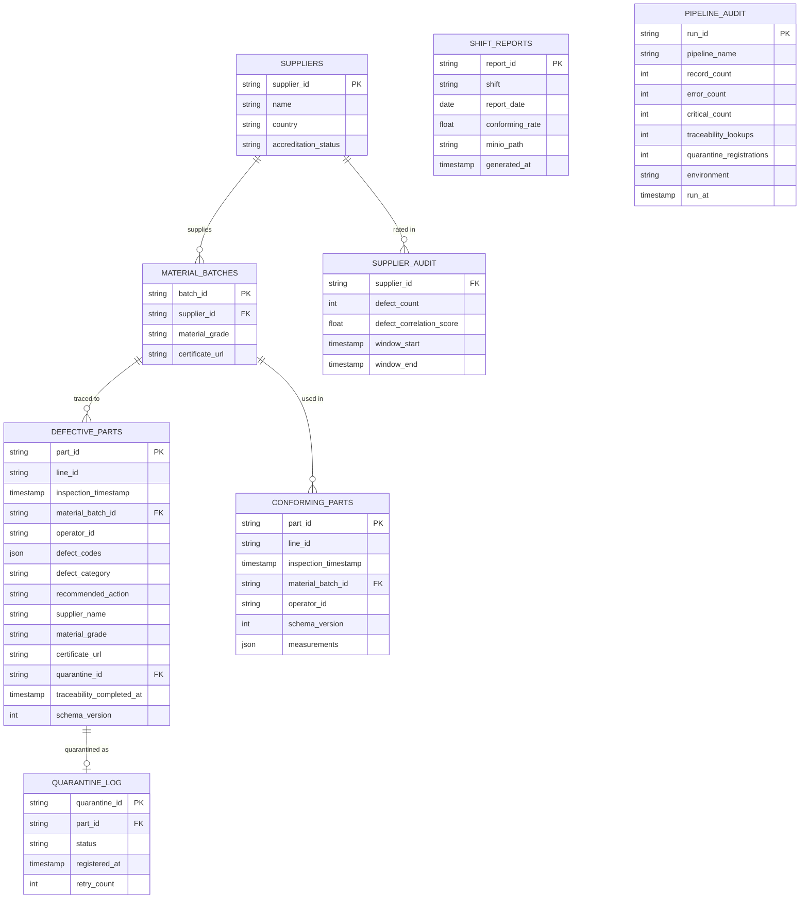

# QTP — Entity Relationship Diagram

Two schemas: `quality` (Postgres — primary source/destination + audit) and `erp` (MySQL —
simulated ERP for supplier traceability).

## Notes
- `DEFECTIVE_PARTS.traceability_completed_at` minus `inspection_timestamp` drives the **2-hour
  SLA** check.
- `PIPELINE_AUDIT` is written by `audit_log_writer` on every pipeline run.
- `schema_version` (written by `schema_version_tagger`) appears on every part record for ISO
  audit traceability.
- `SUPPLIER_AUDIT.defect_correlation_score` backs the supplier quality risk score (stretch).
