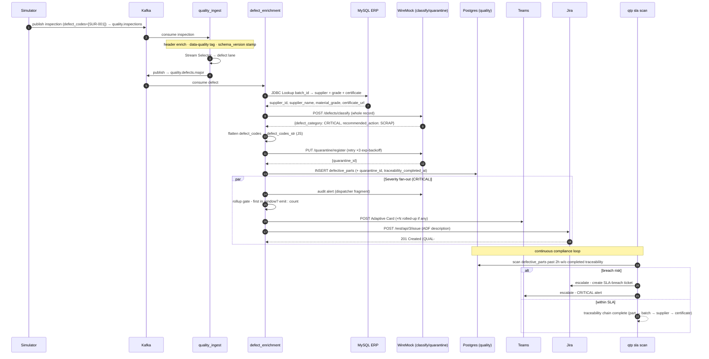

# QTP: Sequence Diagram: one CRITICAL defect, end to end

Traces a single CRITICAL part from inspection to a closed 2-hour traceability record,
across every system it touches. This is the "golden thread" the demo and evidence pack
reproduce deterministically.

## What each hop guarantees (ISO 9001 controls)

| Hop | Control | Evidence |
|-----|---------|----------|
| schema_version stamp | Schema version on every record | `defective_parts.schema_version` |
| ERP lookup | Full traceability chain | supplier + batch + certificate columns |
| classify | Deterministic severity → action | `defect_category`, `recommended_action` |
| quarantine (retry ×3) | Mandatory quarantine of CRITICAL/MAJOR | `quarantine_log`, `quarantine_id` |
| rollup gate + fan-out | Severity-routed alerting, rate-capped | Teams card · Jira ticket · WireMock journal |
| SLA scan | 2-hour traceability SLA | `traceability_completed_at - inspection_timestamp` |

Any stage failure routes the record to the MinIO **dead-letter queue** (visible, recoverable)
rather than dropping it - so a downstream outage never silently loses a defect.
