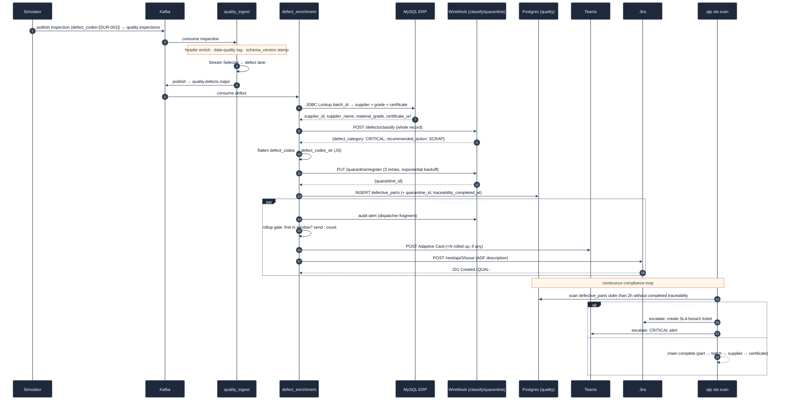

# QTP: sequence diagram for one CRITICAL defect

This diagram follows a single CRITICAL part from inspection to a closed two-hour traceability
record, across every system it touches. The demo and the evidence pack reproduce the same path
with fixed data.

## ISO 9001 controls at each step

| Step | Control | Evidence |
|-----|---------|----------|
| schema_version stamp | Schema version on every record | `defective_parts.schema_version` |
| ERP lookup | Full traceability chain | Supplier, batch, and certificate columns |
| Classify | Deterministic severity and action | `defect_category`, `recommended_action` |
| Quarantine (3 retries) | Mandatory quarantine of CRITICAL and MAJOR parts | `quarantine_log`, `quarantine_id` |
| Rollup gate and routing | Severity-routed, rate-limited alerting | Teams card · Jira ticket · WireMock journal |
| SLA scan | Two-hour traceability SLA | `traceability_completed_at - inspection_timestamp` |

If any stage fails, the record goes to the MinIO dead-letter queue, where it can be seen and
recovered. A downstream outage cannot silently lose a defect.
